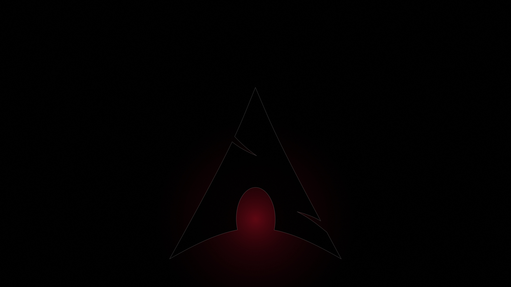

# Crimson Black

OLED black, warm off-white ink, one crimson signal. An [Omarchy](https://omarchy.org) theme.



## Install

```bash
omarchy theme install https://github.com/AspireVenom/omarchy-crimson-black-theme
```

Or paste the URL into **Install > Style > Theme** in the Omarchy menu.

## Palette

| Role | Hex | Notes |
|------|-----|-------|
| background | `#000000` | true black, pixels off on OLED |
| foreground | `#e6e3df` | warm off-white |
| accent / cursor | `#ef2a42` | text-safe crimson, 5.08:1 on black |
| brand crimson | `#e0112b` | borders and wallpapers only |
| selection | `#5c0d16` | deep crimson |
| muted | `#7c7c7c` | |

ANSI colors stay low-chroma (sage, sand, steel, rose) so diffs and warnings remain readable without breaking the black/white/red look.

## What's in here

- `colors.toml`: palette; Omarchy renders waybar, walker, mako, terminals, hyprlock and more from it
- `hyprland.conf`: crimson gradient border on the active window
- `btop.theme`, `neovim.lua`, `vscode.json`, `icons.theme` (Yaru-red)
- `backgrounds/`: four near-black wallpapers with no lit pixels in the bar zone
- `live-wallpaper.glsl`: slow crimson smoke shader for [mpvpaper](https://github.com/GhostNaN/mpvpaper) (optional, used by a live-wallpaper script)
- `unlock.png`: "Aspire" wordmark for the Plymouth disk-unlock screen (`omarchy plymouth set by theme crimson-black`)
- `chromium-extension.optin`: lets a theme-set hook install a matching Chromium theme

The extra integrations (waybar/hyprlock tokens, Spotify, Chromium, live wallpaper, Limine boot menu) live in [AspireVenom/dotfiles](https://github.com/AspireVenom/dotfiles).
